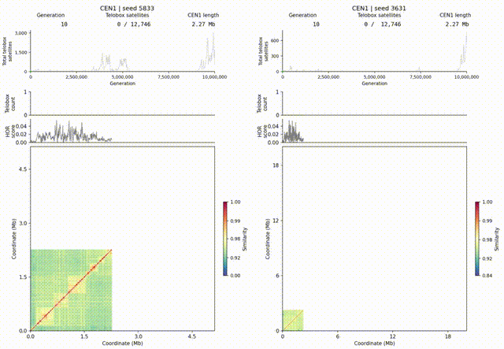

# teloevo

Coarse-grained simulator of centromeric telobox evolution.

<p align="center">
  
</p>

## Installation

Requires **Python 3.9+** and a **C++17 compiler**, such as `g++`. NumPy is
installed automatically. The simulator compiles on first use.

```bash
git clone https://github.com/aedera/teloevo.git
cd teloevo
python3 -m venv .venv
. .venv/bin/activate
python -m pip install --upgrade pip
python -m pip install .
```

For Clang, set `CXX=clang++` before running a simulation.

## Run

Use the real Col-0 CEN1 sequence, satellite annotations and position-specific SNP inputs that are
included in the repository:

```bash
teloevo --generations 1000 --checkpoints 0,100,500,1000 \
  --seed 846 --output cen1_example.npz
```

This simulates the bundled CEN1 for 1,000 generations using seed `846` and
saves checkpoints at generations 0, 100, 500, and 1,000 in `cen1_example.npz`.

The NPZ stores the complete symbolic state at each requested checkpoint,
including satellite sequences and order. Existing output files are never
overwritten.

For another centromere, provide a matching FASTA record and satellite GFF:

```bash
teloevo --fasta reference.fasta --gff satellites.gff3 --chrom Chr2 \
  --generations 1000 --seed 846 --output cen2.npz
```

Optional `--start` and `--end` select an interval using 1-based inclusive
coordinates. Run `teloevo --help` for mutation rates and other options.

## Export a checkpoint

Use a saved checkpoint to reconstruct the centromere's DNA sequence and
satellite annotations. The exporter reads the NPZ output and writes FASTA
and GFF3 files.

```bash
teloevo-export cen1_example.npz --generation 500 \
  --output-prefix cen1_gen500 --seqid CEN1
```

This creates `cen1_gen500.fasta` and `cen1_gen500.gff3`. Omit `--generation`
to export the final saved checkpoint. The GFF3 describes satellite boundaries
in the reconstructed array, with 1-based inclusive coordinates and symbol IDs.

The exporter uses saved data and does not rerun the simulation. It can also be
run directly with `python src/teloevo/export.py` and the same arguments.
Run `teloevo-export --help` for details.
